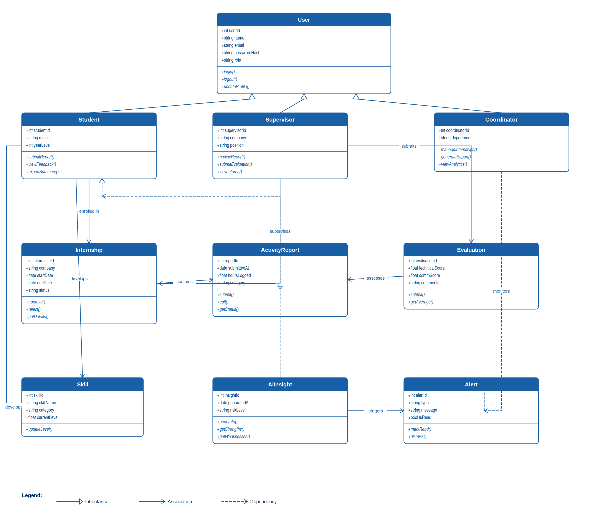
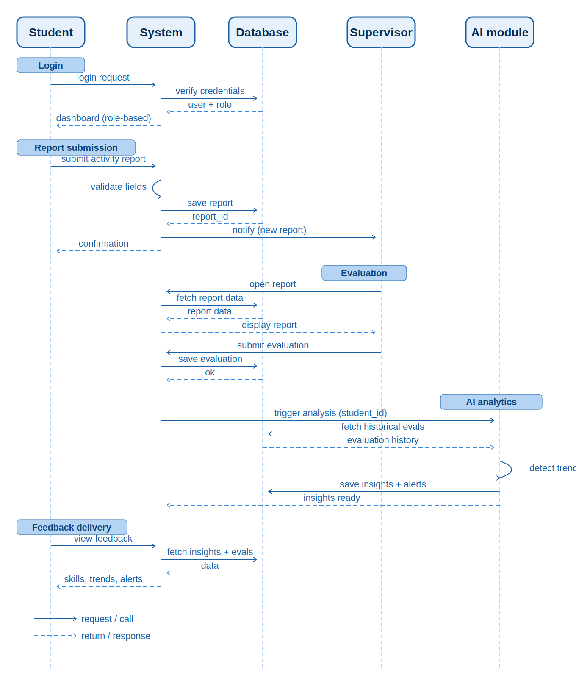

# Nextern — Internship Management System

A full-stack web application built to digitize and streamline the entire internship lifecycle for universities — from student applications to supervisor evaluations and AI-powered performance analytics.

> **Capstone Project** — developed for university submission and selected for real-world implementation.

---

## Tech Stack

**Backend**
- ASP.NET Core MVC (.NET 8)
- Entity Framework Core
- SQL Server
- BCrypt.Net (password hashing)

**Frontend**
- Razor Views (.cshtml)
- Bootstrap 5
- Chart.js
- Bootstrap Icons

**AI & Services**
- Anthropic Claude API (claude-haiku-4-5)
- Custom AI insight engine for performance analytics

---

## Features

### Student
- Apply for internship opportunities posted by coordinators
- Submit weekly/monthly activity reports with file attachments
- Track hours logged, tasks, and progress toward internship completion
- View supervisor feedback and ratings on submitted tasks
- Access AI-generated personal performance insights and predictions

### Supervisor
- Assign tasks to interns with due dates and descriptions
- Review and rate intern task submissions with feedback
- Conduct monthly skill evaluations across multiple competencies
- View AI-generated skill gap analysis and performance trends

### Coordinator
- Post and manage internship opportunities with application deadlines
- Review and approve/reject student internship applications
- Monitor all active interns — hours, tasks, evaluations
- Access AI-powered cohort analysis to identify at-risk students
- View detailed intern profiles with full task and evaluation history

### Admin
- Manage all system users (create, edit, delete, change roles)
- Full visibility across the entire platform

---

## AI Analytics

The system integrates the **Anthropic Claude API** to generate real-time insights:

- **Student Dashboard** — personalized risk level, performance prediction, cohort ranking, skill gap identification
- **Coordinator Dashboard** — cohort-wide analysis, at-risk student detection, top performer identification
- **Supervisor Dashboard** — skill trend analysis, task performance summary, improvement recommendations

All insights are visualized using **Chart.js** (bar charts, doughnut charts, progress trends).

---

## System Diagrams

### Class Diagram


### Sequence Diagram


---

## Setup

1. Clone the repository
2. Copy `IMS.Web/appsettings.example.json` to `IMS.Web/appsettings.json`
3. Fill in your SQL Server connection string and Anthropic API key
4. Run database migrations:
   ```
   dotnet ef database update
   ```
5. Run the application:
   ```
   dotnet run --project IMS.Web
   ```

---

## Roles & Access

| Role | Access |
|------|--------|
| Admin | Full system management |
| Coordinator | Opportunities, applications, intern monitoring |
| Supervisor | Task assignment, evaluations, AI insights |
| Student | Applications, reports, personal dashboard |

---

## Project Structure

```
├── IMS.Web/              # Main MVC web application
│   ├── Controllers/      # Role-based controllers
│   ├── Models/           # Entity models
│   ├── Views/            # Razor views per role
│   ├── Services/         # AI service (Anthropic integration)
│   └── wwwroot/          # Static assets (CSS, JS, images)
├── IMS.API/              # API project
├── IMS_Class_Diagram.png
└── IMS_Sequence_Diagram.png
```

---

## License

This project was developed as a university capstone project.
